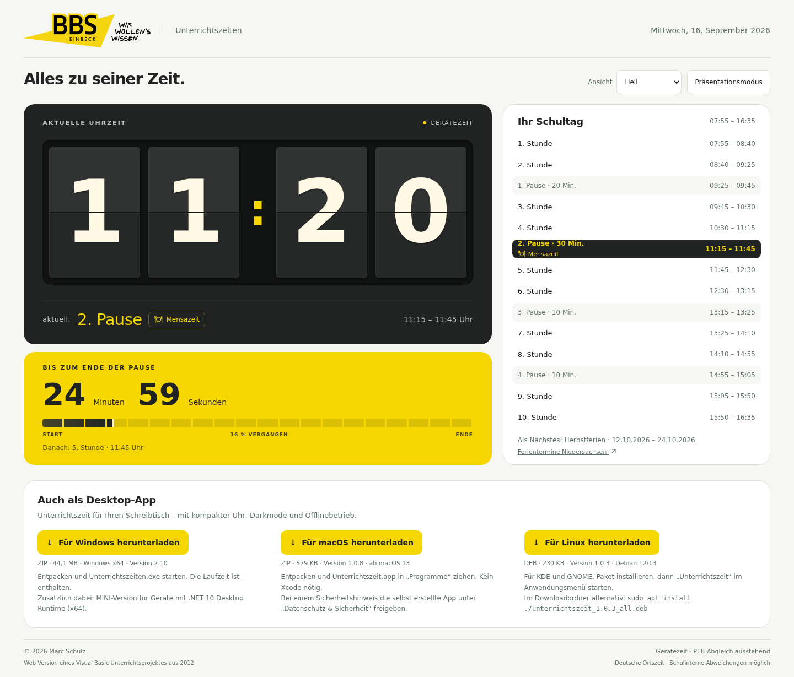
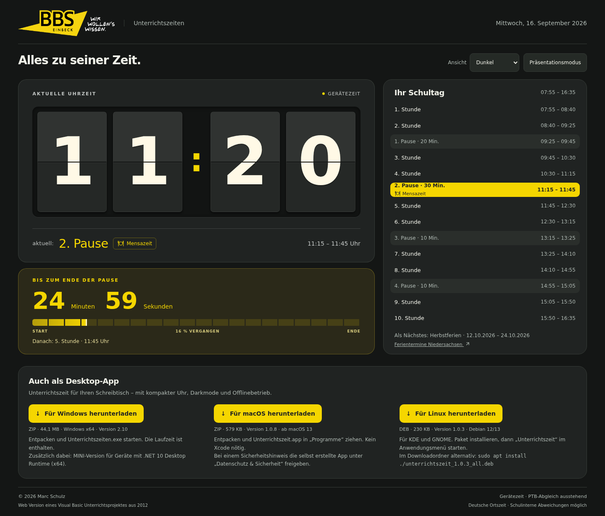
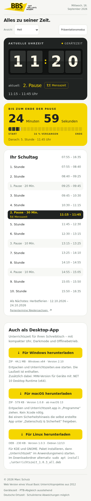

# Unterrichtszeit · BBS Einbeck

[Deutsche Version](README.md) · [Project website & demo](https://mail896.github.io/bbs_unterrichtszeit_public/en.html) · [Desktop downloads](https://github.com/mail896/bbs_unterrichtszeit_public/releases/latest)

**A school day at a glance.** A retro clock, current lesson or break, and a countdown — in a responsive web app and native Windows, macOS and Linux applications. Based on Marc Schulz’s Visual Basic classroom project from 2012.



## Try it

**[Open the live demo →](https://mail896.github.io/bbs_unterrichtszeit_public/demo/)** · [School deployment](https://apps.bbs-einbeck.de/uzeit/)

The demo runs the actual clock with the fixed BBS Einbeck timetable and Europe/Berlin time. No account or backend is required. The application UI and school calendar are German; this documentation and the project website are bilingual. Screenshots use a fixed example date and device time.

## Features

- Large flip-style clock, blinking colon and segmented progress bar.
- Current lesson/break, remaining time, next activity and full daily schedule.
- Lunch break indicator; school day from 07:55 to 16:35.
- Lower Saxony holidays, public holidays, weekends and the shortened day before summer holidays.
- Light, dark and system appearance; responsive iPhone/iPad/desktop layout.
- Web presentation mode; compact native windows and optional always-on-top mode.
- PTB time synchronization with device-time fallback; the system clock is never changed.
- Native applications: click the dark clock card to open the school website/downloads.

<details><summary>Dark and mobile views</summary>





</details>

## Native downloads

| Platform | Version | Installation |
| --- | --- | --- |
| Windows x64 | 2.10 | Extract ZIP and run `Unterrichtszeiten.exe`. MINI needs .NET 10 Desktop Runtime x64. |
| macOS 13+ · Apple Silicon & Intel | 1.0.8 | Extract ZIP and move `Unterrichtszeit.app` into Applications. |
| Debian 12/13 · KDE & GNOME | 1.0.3 | `sudo apt install ./unterrichtszeit_1.0.3_all.deb`; launch from the application menu. Also tested on Raspberry Pi 5. |

**[Download applications →](https://github.com/mail896/bbs_unterrichtszeit_public/releases/latest)**

Native apps include the UI and calendar for offline use. Initial Linux installation may need internet access for dependencies. The web app does not guarantee offline caching. Windows binaries are unsigned; macOS is locally/ad-hoc signed, not notarized.

## Scope

This is a fixed school timetable, not a personal class schedule. Calendar coverage: **2026 through 21 August 2030**, without automatic holiday updates. Local school exceptions may differ; an expiry notice appears when coverage ends.

## Build and test

```sh
npm ci --ignore-scripts
npm run check
npm run pages:build
python3 -m http.server --bind 127.0.0.1 --directory dist/pages 8080
```

[Installation & native builds](docs/INSTALLATION.en.md) · [Architecture](docs/ARCHITEKTUR.md) · [Privacy](docs/PRIVACY.md)

`public/` contains the web app; `native/`, `macos/` and `linux/` contain the platform sources. `site/` is the bilingual project website; `scripts/`, `tests/` and `images/` provide builds, checks and screenshots.

Public snapshot: **3 October 2026**, with its own history. Platform versions are independent. Internal operations notes, historical drafts and local build outputs are excluded.

© 2026 Marc Schulz · BBS Einbeck. [MIT license](LICENSE) · [Assets](docs/ASSETS.md) · [Dependencies](docs/DEPENDENCIES.md) · [Security](SECURITY.md)

The confirmed Mac download is 1.0.8. Source includes window-size fixes through 1.0.10; their long-running behavior has not yet been confirmed.
